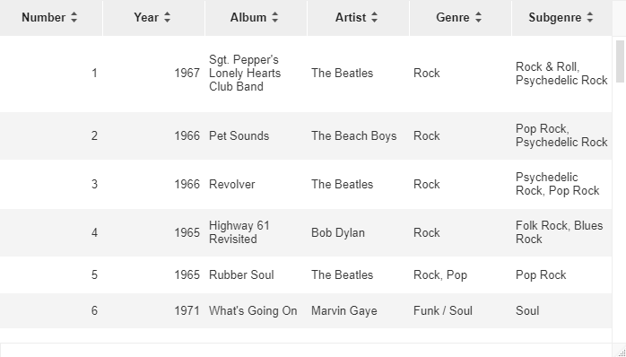
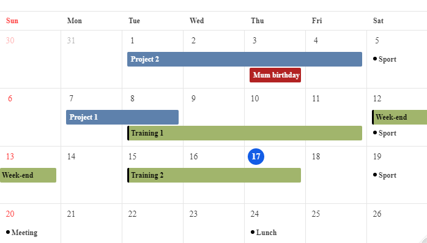
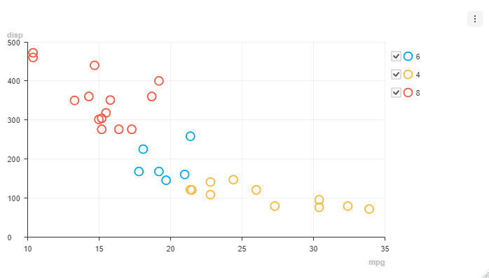

# toastui

``` r

library(toastui)
```

[htmlwidgets](https://www.htmlwidgets.org/) to create:

- [`datagrid()`](https://dreamrs.github.io/toastui/reference/datagrid.md):
  Interactive tables with data editing, filtering, sorting, and more
- [`calendar()`](https://dreamrs.github.io/toastui/reference/calendar.md):
  Interactive daily, weekly or monthly calendar
- [`chart()`](https://dreamrs.github.io/toastui/reference/chart.md):
  Interactive charts

## Grid

Create interactive tables with lot of options to customize content and
that you can edit in Shiny applications.

    datagrid(rolling_stones_50)



⇨ [See full documentation and interactive
examples](https://dreamrs.github.io/toastui/articles/extras/grid.html)

## Calendar

Create interactive calendars that you can navigate and display
schedules. In Shiny you can add, update or delete schedules.

    calendar(cal_demo_data())



⇨ [See full documentation and interactive
examples](https://dreamrs.github.io/toastui/articles/extras/calendar.html)

## Chart

Create interactive charts:

    chart(mtcars, caes(mpg, disp, color = cyl), type = "scatter")



⇨ [See full documentation and interactive
examples](https://dreamrs.github.io/toastui/articles/extras/chart.html)

## Editor

Create interactive Markdown WYSIWYG editor:

    editor(previewStyle = "vertical")


