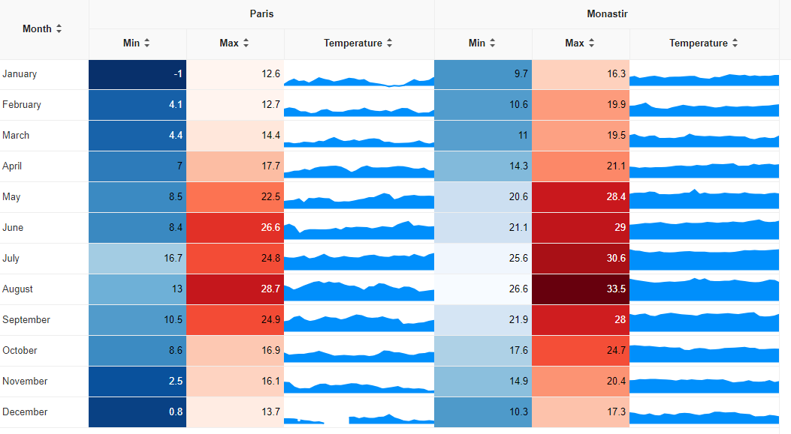
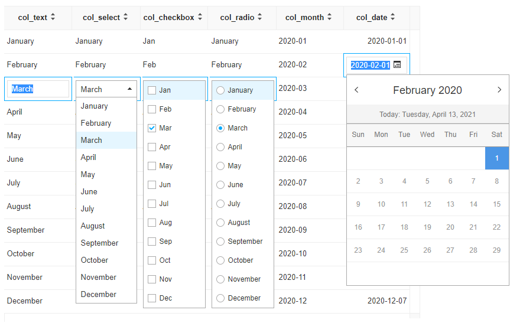
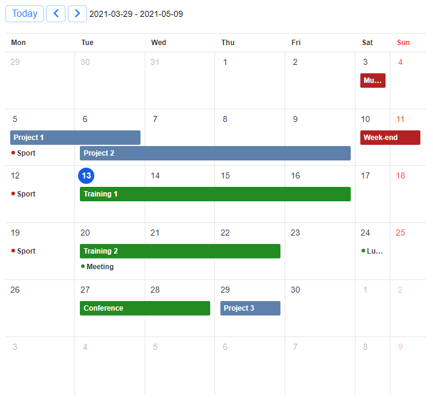
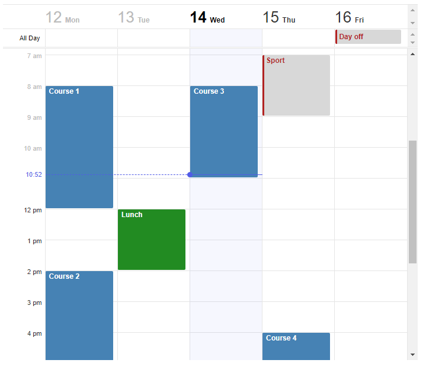
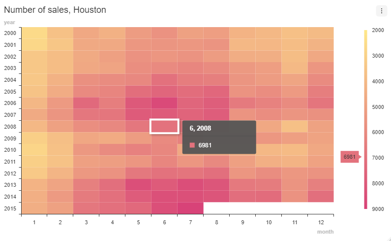
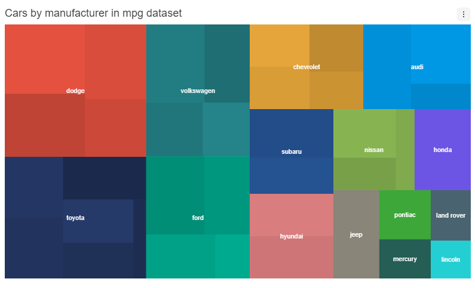
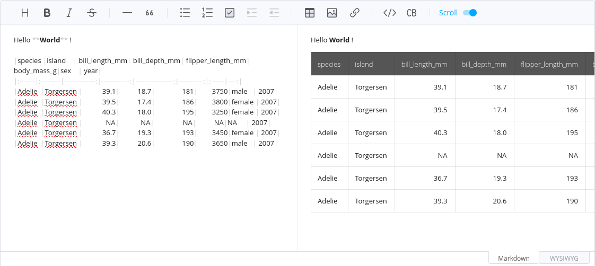

# toastui

> R Htmlwidgets for [TOAST UI](https://ui.toast.com/) JavaScript
> libraries: [Grid](https://ui.toast.com/tui-grid/),
> [Calendar](https://ui.toast.com/tui-calendar/),
> [Chart](https://ui.toast.com/tui-chart/) and
> [Editor](https://ui.toast.com/tui-editor/).

## Installation

Install from [CRAN](https://CRAN.R-project.org/package=toastui) with:

``` r

install.packages("toastui")
```

Or install the development version from
[GitHub](https://github.com/dreamRs/toastui) with:

``` r

# install.packages("remotes")
remotes::install_github("dreamRs/toastui")
```

## Grid

Interactive tables with data editing, filtering, sorting, and more. See
documentation and examples:



Edit mode example:



## Calendar

Interactive daily, weekly or monthly calendar. See documentation and
examples:

- Monthly view:



- Weekly view:



## Chart

Interactive charts:



## Editor

Interactive Markdown WYSIWYG Editor:



## Development

This package uses [packer](https://github.com/JohnCoene/packer) to
manage JavaScript source code and dependencies. If you want to modify
it, you’ll need a working installation of [Node.js](https://nodejs.org).

After cloning the Git repository, install nodes modules with:

``` r

packer::npm_install()
```

Modify code in `srcjs/` directory, then run:

``` r

packer::bundle_prod() # or packer::bundle_dev()
```

Re-install the package or use `pkgload::load_all()` to try changes.
